# EnterprisePulse .NET

[](https://dotnet.microsoft.com/)
[](https://learn.microsoft.com/aspnet/core)
[](https://dotnet.microsoft.com/apps/aspnet/web-apps/blazor)
[](https://mudblazor.com/)
[](https://www.postgresql.org/)
[](https://www.hangfire.io/)
[](https://learn.microsoft.com/ef/core/)

**EnterprisePulse**, çok şirketli (multi-tenant) kurumsal bir ERP sistemidir. Bu repo, NestJS / React orijinalinin **ASP.NET Core 10 + Blazor Server (MudBlazor)** ile yeniden yazımıdır: tek çözümde API, Hangfire işleri ve web arayüzü.

| Repo | İçerik |
| --- | --- |
| **EnterprisePulse.NET** (bu repo) | ASP.NET Core API + Blazor arayüz |
| [EnterprisePulse.Java](https://github.com/hamzamaral/EnterprisePulse.Java) | Spring Boot 3.5 + Vaadin 24 yeniden yazımı |
| [EnterprisePulse](https://github.com/hamzamaral/EnterprisePulse) | NestJS / React orijinali, yol haritası, ADR |
| [enterprise-pulse-api](https://github.com/hamzamaral/enterprise-pulse-api) · [enterprise-pulse-web](https://github.com/hamzamaral/enterprise-pulse-web) | Orijinal API / SPA repoları |

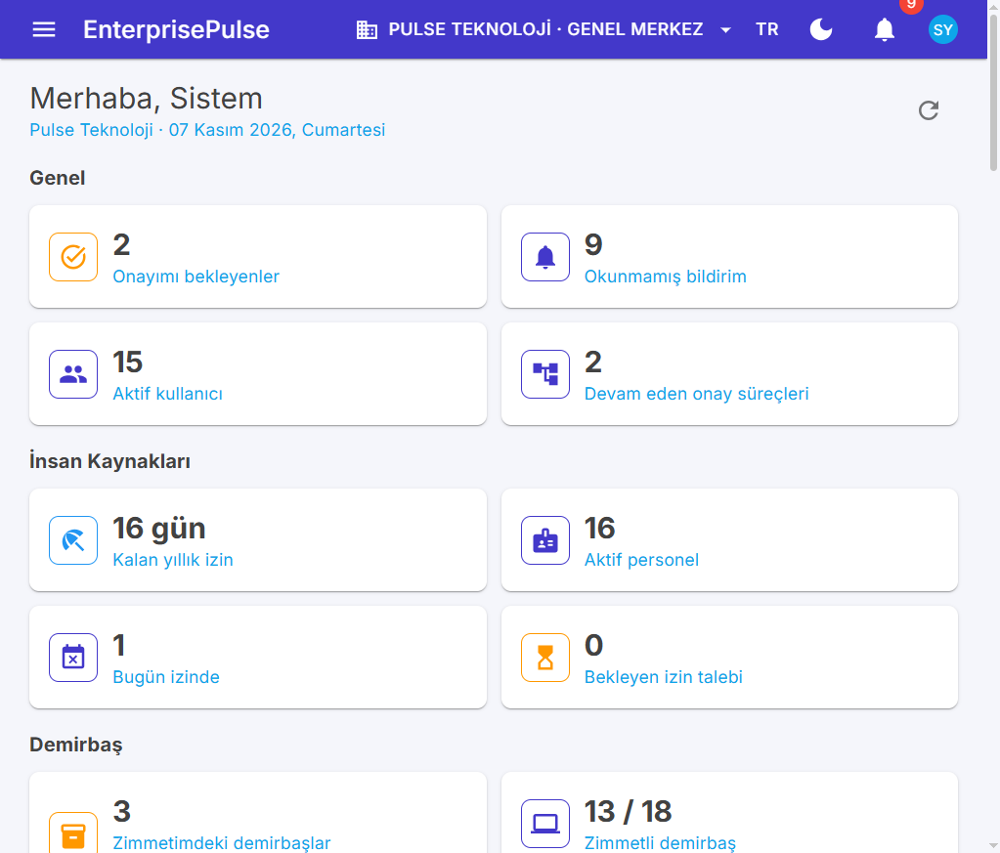

> Demo seed **Pulse Teknoloji · Genel Merkez** şirketinde doludur. Üst bardan şirket seçerken **Pulse Lojistik** seçerseniz çoğu liste boş görünür — bu bir hata değil, ikinci şirket için operasyonel seed yoktur.

## Ekranlar

| | |
| --- | --- |
| 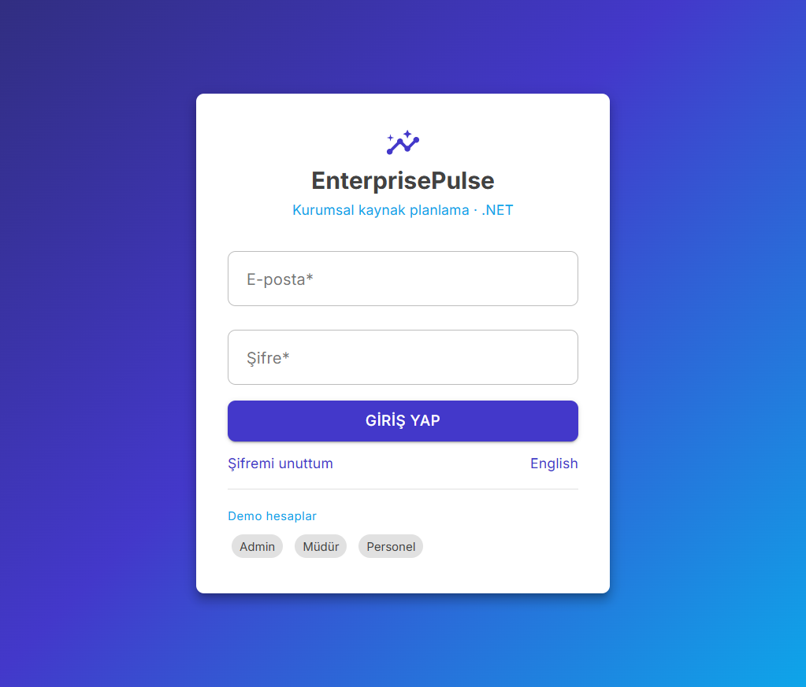 |  |
| **Giriş:** demo hesaplar, TR/EN, şirket bağlamı | **Gösterge paneli:** yetkiye göre KPI kartları |
| 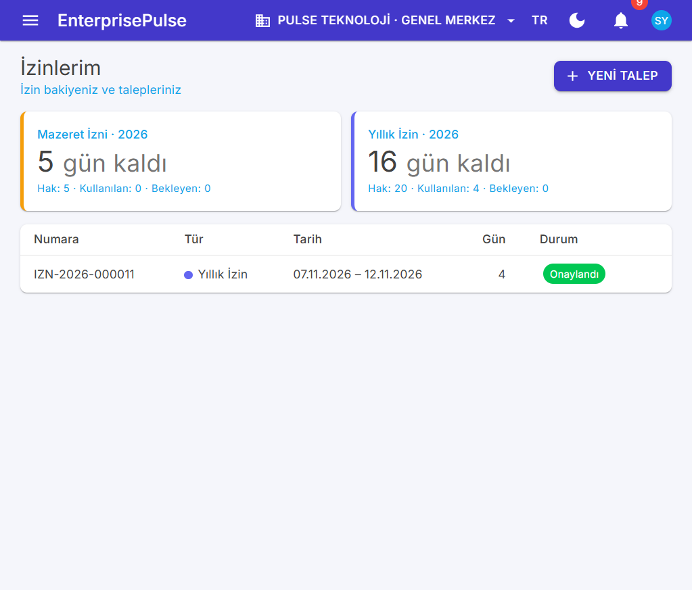 | 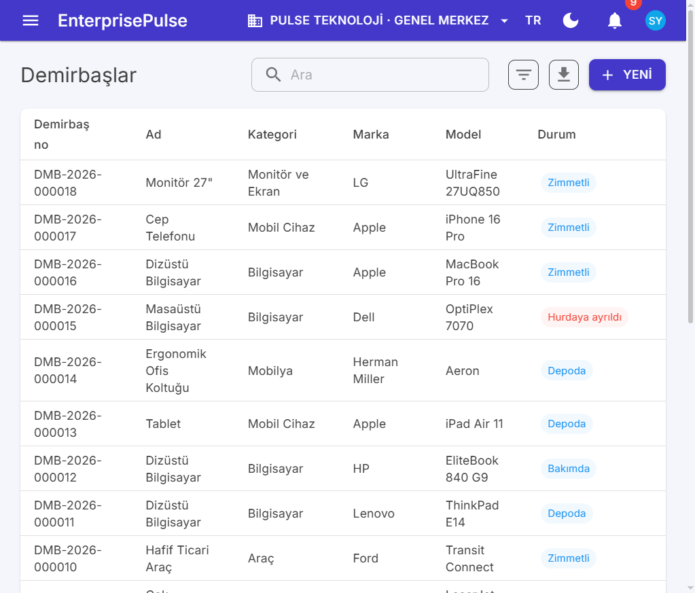 |
| **İzinlerim:** bakiye kartları, kendi talepleri | **Demirbaşlar:** zimmet / depo / hurda durumları |
| 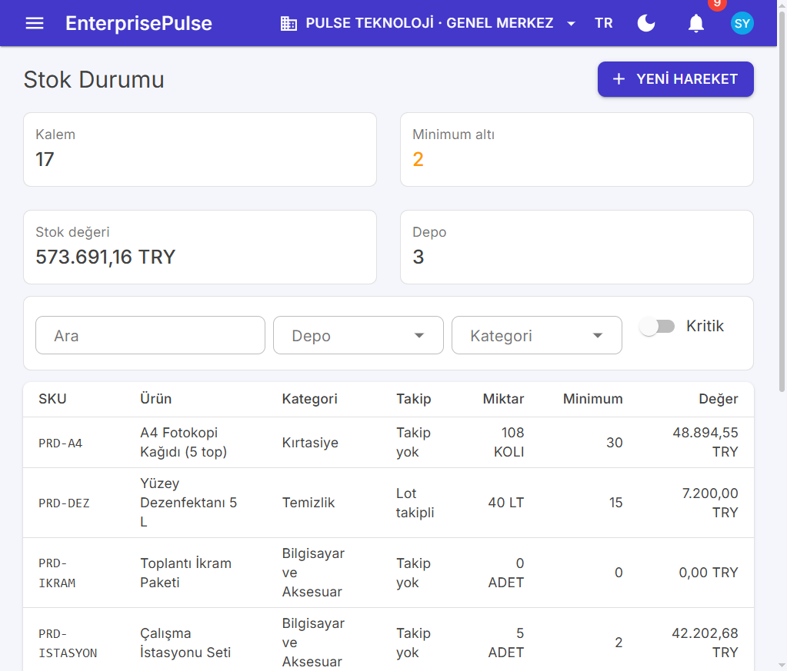 | 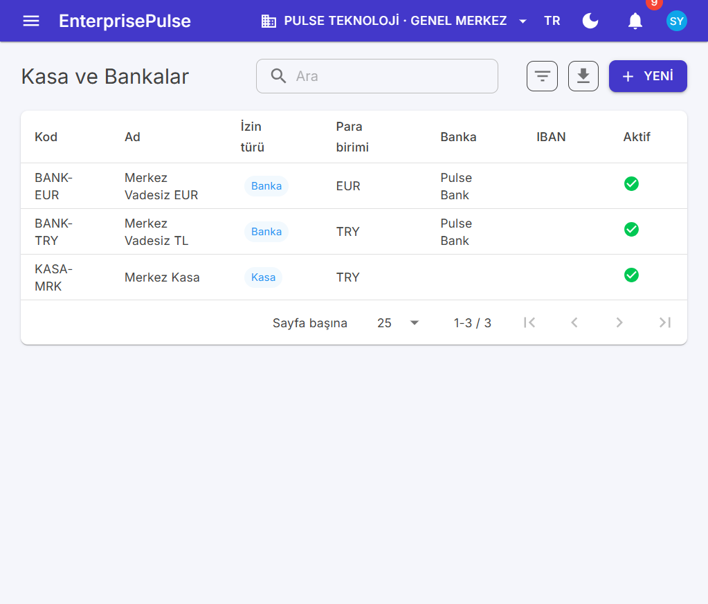 |
| **Stok durumu:** kritik stok, depo değeri, filtreler | **Kasa ve bankalar:** TRY/EUR kasa · banka hesapları |
| 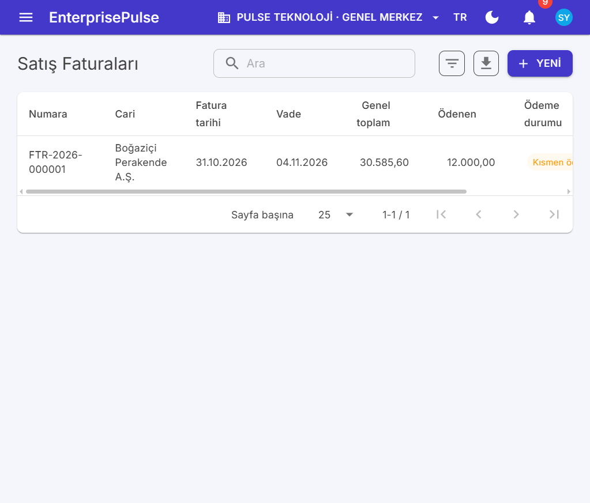 | 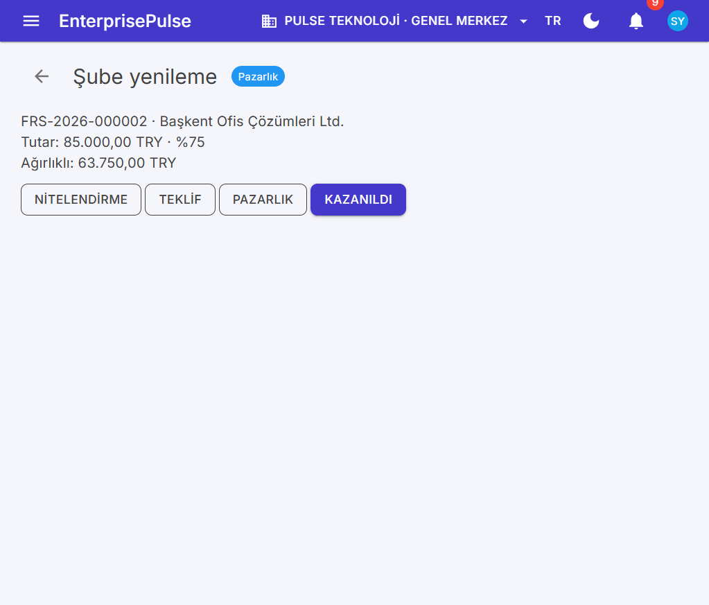 |
| **Satış faturaları:** kısmi tahsilat durumu | **CRM fırsat:** aşama butonları, ağırlıklı tutar |
| 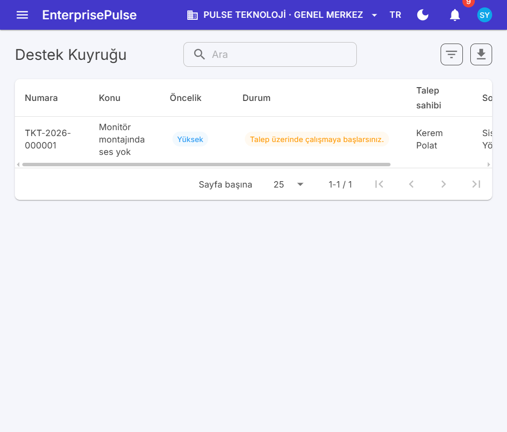 | 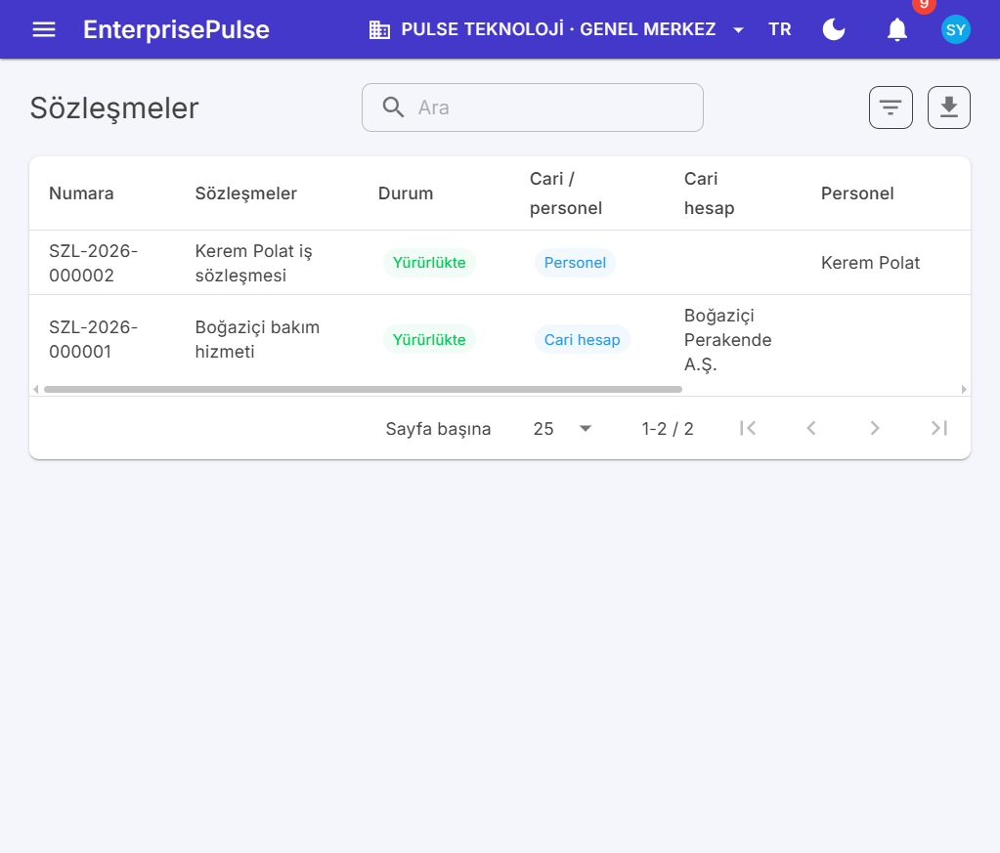 |
| **Destek kuyruğu:** öncelik ve durum etiketleri | **Sözleşmeler:** cari / personel, yürürlükte |
| 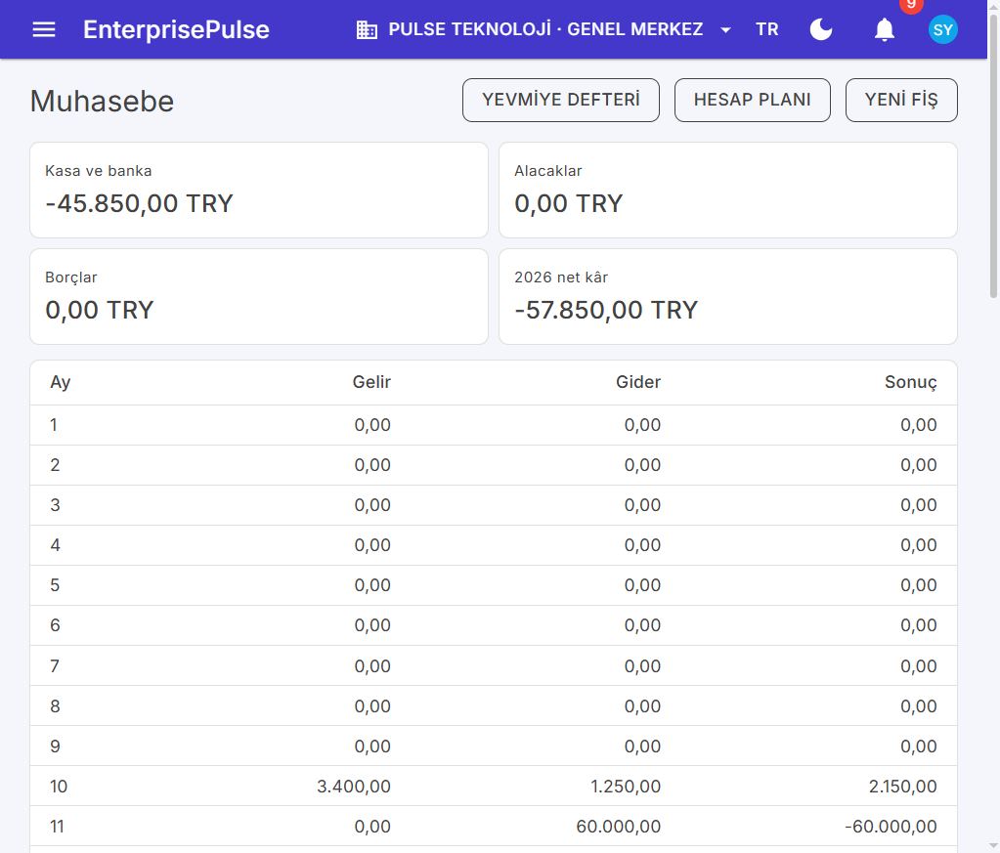 | 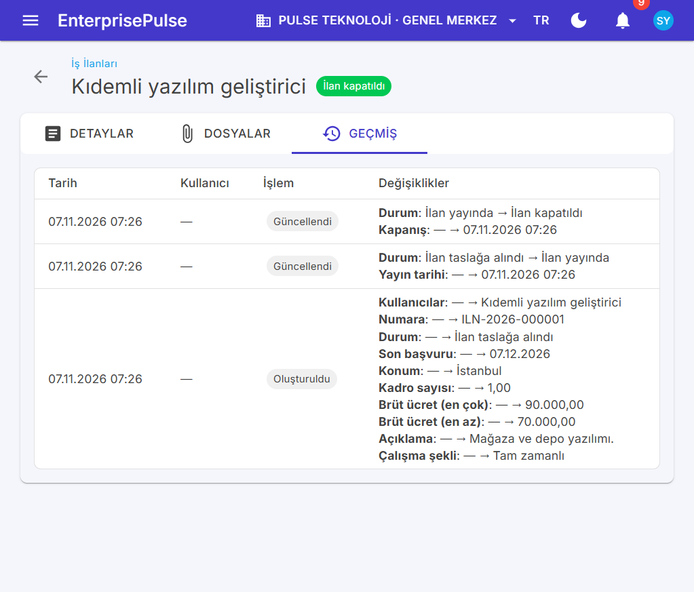 |
| **Muhasebe:** kasa, alacak/borç, aylık gelir-gider | **Geçmiş:** alan etiketli okunabilir denetim |

## Hızlı başlangıç

Gereksinimler: **.NET 10 SDK**, Docker.

```bash
docker compose up -d
# Postgres 5442 · RustFS 9010/9011 · Mailpit 1035/8035

dotnet run --project src/EnterprisePulse.Api --launch-profile http
# http://localhost:5100  ·  Swagger: /swagger  ·  Hangfire: /hangfire

dotnet run --project src/EnterprisePulse.Web --launch-profile http
# http://localhost:5101
```

API açılışta migration uygular ve demo verisini yükler.

### Demo kullanıcılar

| Rol | E-posta | Şifre |
| --- | --- | --- |
| Sistem yöneticisi | `admin@enterprisepulse.dev` | `Admin123!` |
| Müdür | `manager@enterprisepulse.dev` | `Manager123!` |
| Personel | `employee@enterprisepulse.dev` | `Employee123!` |

### Yerel servisler

| Servis | Adres |
| --- | --- |
| API | http://localhost:5100 |
| Swagger | http://localhost:5100/swagger |
| Web (Blazor) | http://localhost:5101 |
| Hangfire | http://localhost:5100/hangfire |
| Mailpit | http://localhost:8035 |
| RustFS (S3) | http://localhost:9011 |

### Testler

```bash
dotnet test
# UnitTests + IntegrationTests — Postgres 5442 gerekir
```

Son koşuda: **48 birim + 27 entegrasyon = 75/75**.

## Özellikler

- **Platform:** JWT giriş, şirket / şube değiştirme, kullanıcı · rol · izin, denetim kaydı (okunabilir Geçmiş sekmesi), SignalR bildirimleri, onay kutusu, ayarlar (para birimi, kur, KDV, birim, numaralandırma, onay akışları). Arka plan işleri **Hangfire + PostgreSQL** (Redis / BullMQ yok).
- **Gösterge paneli:** yetkiye göre İK, zimmet, stok ve finans KPI’ları; personel için kalan izin, zimmetler, masraflar ve görevler.
- **İnsan Kaynakları:** personel, departman, pozisyon, organizasyon şeması, izin talebi ve çok adımlı onay, **İzinlerim** / **Mesaim**, puantaj, vardiya planı.
- **Zimmet ve Demirbaş:** demirbaş kartı, QR etiket, zimmet / iade / devir, amortisman, sayım, **Zimmetlerim**.
- **Stok ve Depo:** stok durumu ve kritik filtre, ürün / varyant, lot · seri, giriş / çıkış / transfer / düzeltme, sayım.
- **Satın Alma / Satış / Finans:** teklif, sipariş, irsaliye, fatura; cari hesaplar; kasa / banka, çek · senet, ödeme / tahsilat, yaşlandırma.
- **CRM:** potansiyel müşteri, fırsat aşamaları, aktiviteler.
- **Masraf ve Harcırah:** self-servis formlar, onay, finans ödemesi.
- **Proje Yönetimi:** proje, ekip, görevler, zaman çizelgesi.
- **Bordro / İşe Alım / Performans / Eğitim:** dönem hesaplama, ücret pusulası; iş ilanı ve başvuru hattı; değerlendirme dönemi; eğitim oturumları ve uyum.
- **Destek / Sözleşme / Bütçe / Filo:** SLA’lı ticket kuyruğu, sözleşme takvimi, departman bütçesi, araç · yakıt · belge uyarıları.
- **Muhasebe / e-Fatura / Üretim:** tekdüzen hesap planı, yevmiye, mizan · bilanço · gelir tablosu; UBL-TR kuyruk simülasyonu; ürün ağacı, iş emri, MRP.

## Modüller (menü)

| Bölüm | Örnek ekranlar |
| --- | --- |
| Genel | Gösterge paneli, Onay kutum |
| İnsan Kaynakları | İzinlerim, Mesaim, Personel, Puantaj, Vardiya |
| Masraf ve Harcırah | Masraflarım, Masraf formları |
| Bordro | Bordrolar, Bordrolarım, Ücretler |
| İşe Alım | İş ilanları, Adaylar, Mülakatlarım |
| Performans ve Eğitim | Değerlendirmeler, Eğitimlerim |
| Destek | Destek kuyruğu, Destek taleplerim |
| Proje Yönetimi | Projeler, Görevlerim, Zaman çizelgesi |
| Zimmet ve Demirbaş | Demirbaşlar, Zimmetlerim, Sayım |
| Stok ve Depo | Stok durumu, Ürünler, Hareketler |
| Üretim | İş emirleri, Ürün ağacı, MRP |
| Satın Alma / Satış | Teklif, sipariş, irsaliye, fatura |
| CRM | Fırsatlar, Potansiyel müşteriler, Aktiviteler |
| Cari ve Finans | Cari hesaplar, Kasa ve bankalar, Çekler, Ödemeler |
| Muhasebe | Panel, Yevmiye, Hesap planı, Mizan, e-Fatura |
| Sözleşmeler / Bütçe / Filo | Sözleşmeler, Bütçeler, Araçlar |
| Sistem | Kullanıcılar, Roller, Ayarlar, Denetim |

## Yapı

```
EnterprisePulse.sln
├── src/
│   ├── EnterprisePulse.Core   # varlıklar, EF Core, kimlik, yetki, iş akışı, modül servisleri, seed
│   ├── EnterprisePulse.Api    # Minimal API, JWT, Hangfire, SignalR, Swagger
│   └── EnterprisePulse.Web    # Blazor Server + MudBlazor (metadata’dan liste / form / detay)
├── tests/
│   ├── EnterprisePulse.UnitTests
│   └── EnterprisePulse.IntegrationTests
├── tools/codegen              # Prisma şemasından C# varlık + metadata.json
└── docker-compose.yml
```

```bash
node tools/codegen/emit-csharp.mjs
```

## Kardeş projeler

Aynı domain modeli üç stack’te:

| Proje | API | UI | İş kuyruğu | Portlar |
| --- | --- | --- | --- | --- |
| [EnterprisePulse](https://github.com/hamzamaral/EnterprisePulse) | NestJS | React | Redis + BullMQ | 3000 / 5173 |
| **EnterprisePulse.NET** | ASP.NET 10 | Blazor | Hangfire + Postgres | 5100 / 5101 |
| [EnterprisePulse.Java](https://github.com/hamzamaral/EnterprisePulse.Java) | Spring Boot 3.5 | Vaadin 24 | `@Scheduled` + ShedLock | 8180 / 8181 |

## Lisans

Özel / eğitim amaçlı yeniden yazım. Orijinal yol haritası: [EnterprisePulse](https://github.com/hamzamaral/EnterprisePulse).
